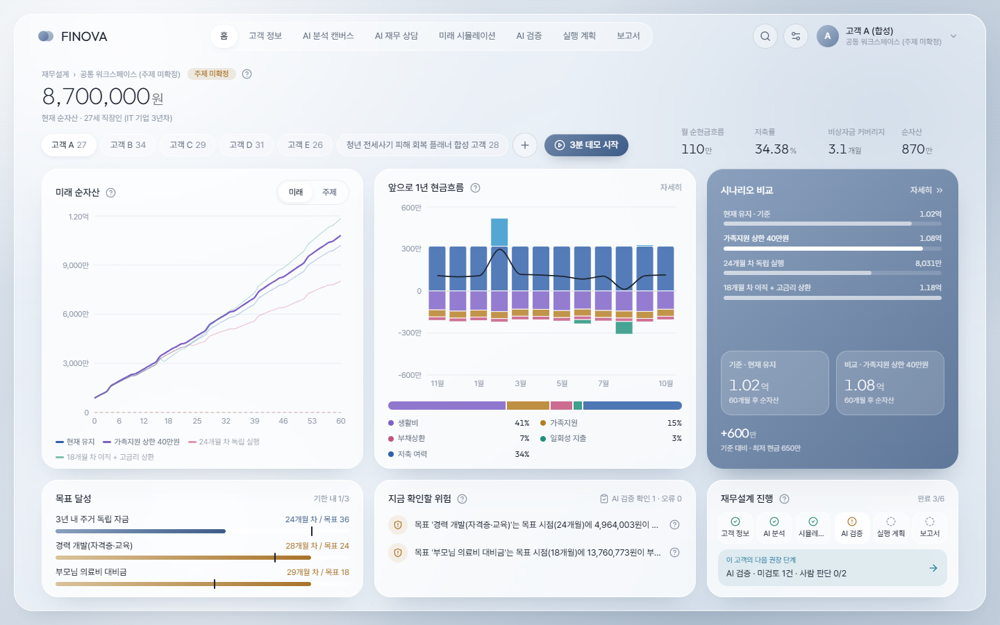
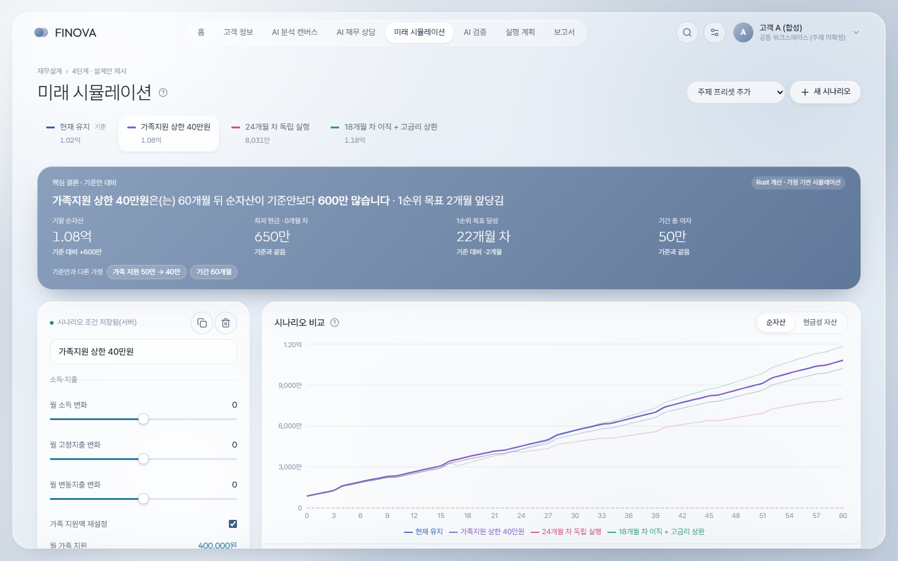
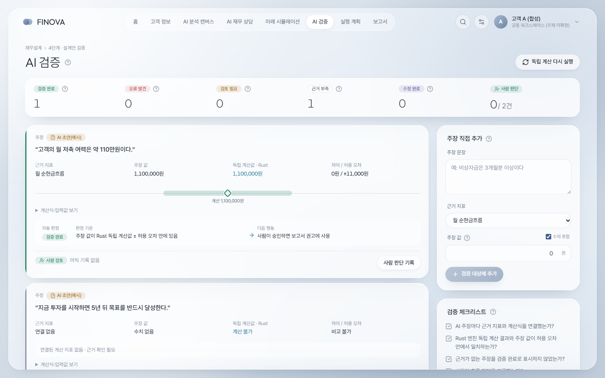
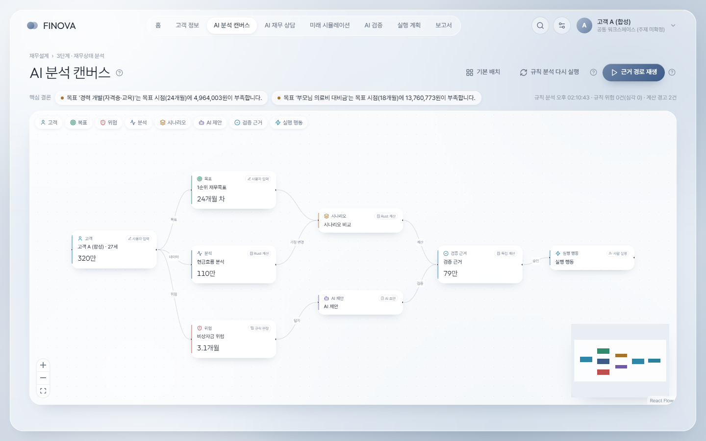
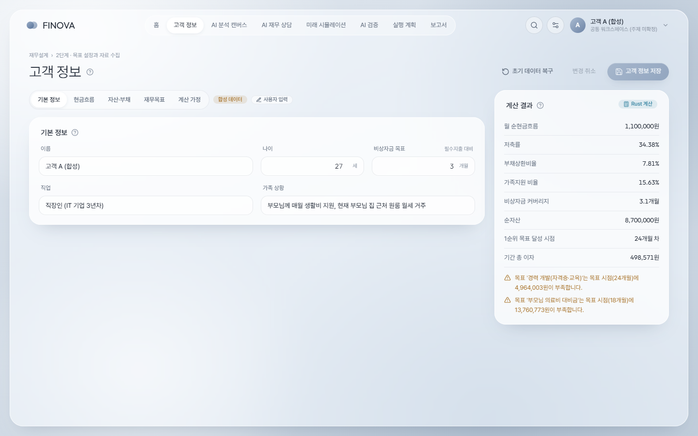

# 합격해도 끝나지 않는다 — CPA 수험생 소득 공백 재무설계 (AFPK 영 플래너 챌린지 2026)

> **최종 아이디어 확정(2026-11-11).** 제출 사이트는 홈 `/` · 고객 정보 `/client` · AI 분석 `/canvas` · AI 상담 `/copilot` · 시뮬레이션 `/simulator` · AI 검증 `/verification` · 실행 계획 `/plan` · 보고서 `/report` 이며,
> 계산 모델·기획서 수치 재계산·달라진 점은 [docs/CPA_FINAL_IDEA.md](docs/CPA_FINAL_IDEA.md)에 정리했다.
> 이전 FINOVA 범용 워크스페이스(`/workspace`, 아이디어 설정 화면 포함)의 프론트엔드는 2026-11-11 팀 결정으로 삭제했다(git 기록에 남아 있음). 아래 설명 중 범용 워크스페이스 화면 부분은 더 이상 사이트에 없다.

# FINOVA — AI 재무설계 워크스페이스

**제1회 전국 대학생 AI 재무설계 사례 콘테스트(AFPK 영 플래너 챌린지 2026)** 출품을 위해 대학생 4인 팀이 만드는 웹 애플리케이션입니다.

AI가 낸 재무설계 제안을 **Rust 계산 엔진이 독립적으로 다시 계산해 검증**하고, 최종 판단은 **사람이 사유와 함께 기록**하는 구조를 보여주는 것이 핵심입니다.
표준 재무설계 6단계(관계 정립 → 목표·자료 수집 → 분석 → 설계안 제시 → 실행 → 점검)를 화면과 데이터 흐름으로 연결했습니다.

> - 모든 고객은 **합성 데이터**이며 실제 인물·통계가 아닙니다.
> - 미래 수치는 입력한 가정에 따른 **시뮬레이션**이며 확정된 결과나 투자 권유가 아닙니다.
> - 최종 공모전 주제는 아직 정하지 않았습니다. 기본 활성 주제는 `공통 워크스페이스(주제 미확정)`이고, 5개 후보 주제는 관리자 화면에서 미리보기·검증 후 적용합니다.



---

## 목차

1. [심사위원 3분 데모 동선](#심사위원-3분-데모-동선)
2. [화면 구성](#화면-구성)
3. [AI는 어디에 쓰이나 (정직한 구현 범위)](#ai는-어디에-쓰이나-정직한-구현-범위)
4. [빠른 시작](#빠른-시작)
5. [환경 변수](#환경-변수)
6. [테스트와 품질 점검](#테스트와-품질-점검)
7. [폴더 구조](#폴더-구조)
8. [주제 전환 (Adaptive Idea Engine)](#주제-전환-adaptive-idea-engine)
9. [알려진 제한 사항](#알려진-제한-사항)
10. [문서](#문서)

---

## 심사위원 3분 데모 동선

홈에서 **「3분 데모 시작」** 을 누르면 화면 아래 안내 막대가 단계·볼 것·다음 이동을 알려줍니다.

| 순서 | 화면 | 시간 | 확인할 것 |
|---:|---|---:|---|
| 1 | 고객 정보 | 30초 | 소득을 바꾸면 **저장 전에도** 계산 결과가 「저장값 → 편집값」으로 바뀜 |
| 2 | AI 분석 캔버스 | 30초 | 「AI 제안」 노드 → AI 초안 주장과 검증 판정, 노드마다 출처 라벨 |
| 3 | 미래 시뮬레이션 | 40초 | 시나리오 선택 → **핵심 결론**(기준안 대비 변화·가정) → 슬라이더로 재계산 |
| 4 | AI 검증 | 40초 | AI 주장 vs Rust 독립 계산값 · 허용 오차 · 판정 기준 · **사람 판단 기록** |
| 5 | 실행 계획 | 20초 | 실행 항목·기한·예상 금액·재점검 조건 |
| 6 | 보고서 | 20초 | 섹션별 출처 표시, 인쇄 · PDF 저장(A4 여러 쪽) |

홈 오른쪽 아래 **「이 고객의 다음 권장 단계」** 는 실제 데이터(미검토 검증 주장, 저장 시나리오 수, 실행 항목 착수 여부 등)로 계산됩니다.

---

## 화면 구성

| 경로 | 화면 | 핵심 기능 |
|---|---|---|
| `/` | 홈 | 순자산·KPI, 미래 순자산, 1년 현금흐름, 시나리오 비교, 목표 달성, 지금 확인할 위험, 재무설계 진행·다음 권장 단계 (데스크톱 한 화면) |
| `/client` | 고객 정보 | 기본 정보 / 현금흐름 / 자산·부채 / 재무목표 / 계산 가정 탭, 저장 전 변경 목록과 계산 결과 비교 |
| `/canvas` | AI 분석 캔버스 | React Flow 노드 그래프, 출처 라벨, 상세 패널(입력·가정·계산·AI 초안·검증), 근거 경로 재생 |
| `/copilot` | AI 재무 상담 | 계산 근거로 답하는 질의응답, Gemini 호출 상태·전달 데이터 범위·실패 시 재시도 |
| `/scenarios` | 미래 시뮬레이션 | 핵심 결론 → 시나리오 비교(경로·비교표) → 상세 근거 탭(현금흐름·달력·자산부채·목표·경고) |
| `/verification` | AI 검증 | 주장 → 근거 → 독립 계산 → 허용 오차 → 판정 기준 → 다음 행동 → 사람 검토(검토자·시점·사유·수정 요구) |
| `/actions` | 실행 계획 | 우선순위·목표 날짜·예상 금액·진행 상태·재점검 조건 |
| `/report` | 보고서 | 9개 섹션 자동 조립, 섹션별 출처 배지, 브라우저 인쇄 기반 PDF |
| `/studio` | 아이디어 설정(관리자) | 주제 입력·프리셋 선택 → 분석 → 생성 → 검증 → 미리보기 → 적용·되돌리기 |

| 미래 시뮬레이션 | AI 검증 |
|---|---|
|  |  |
| **AI 분석 캔버스** | **고객 정보** |
|  |  |

---

## AI는 어디에 쓰이나 (정직한 구현 범위)

화면에서는 결과의 출처를 색이 아니라 **아이콘 + 글자 배지**로 구분합니다.

| 배지 | 의미 | 쓰이는 곳 |
|---|---|---|
| AI 생성 문장 | 외부 LLM(Gemini)이 서버에서 작성한 문장 | **AI 재무 상담 답변 문장만** |
| Rust 계산 | Rust 엔진이 입력값으로 결정적으로 계산한 값 | 모든 지표·시뮬레이션·독립 검증 |
| 규칙 엔진 | 미리 정의한 임계값 규칙으로 판정(LLM 미호출) | 위험 탐지, 캔버스 분석, 에이전트 역할 |
| AI 초안(예시) | 주제 구성에 **미리 작성된** AI 초안 주장(실시간 호출 아님) | AI 검증의 검증 대상 |
| 사용자 입력 | 고객 정보에서 입력한 합성 데이터 | 고객·목표 |
| 사람 판단 | 검토자가 기록한 승인·기각·수정 | AI 검증, 보고서 |

- **Gemini 호출 경로:** 브라우저 → Rust 서버 → Gemini API. API 키는 서버 환경변수에만 있고 프론트엔드에서 LLM을 직접 호출하지 않습니다.
- **LLM에 보내는 데이터:** 합성 고객의 이름·나이·직업·가족 상황·계산 가정, Rust 계산 지표·예측 요약·목표·경고, 규칙 엔진 초안 답변.
- **답변 검증:** 답변 속 금액·비율을 서버가 계산값과 자동 대조하고, 맞지 않는 숫자는 빨간색으로 표시합니다. 호출에 실패하면 규칙 엔진 답변과 실패 사유를 보여주고 다시 시도할 수 있습니다.
- **보고서 문장은 LLM이 쓰지 않습니다.** 템플릿 문구에 입력값·계산값·규칙 판정·사람 판단을 채워 조립합니다.
- 검증 판정에서 「근거 부족」「검토 필요」는 **절대 성공으로 표시하지 않으며**, 사람 판단이 없는 주장은 보고서 권고 근거에서 제외됩니다.
- 키가 없으면 전 기능이 규칙 엔진 + Rust 계산으로 동작하며, 화면에 「LLM 미호출」로 표시됩니다.

---

## 빠른 시작

### 필요 환경
- Windows 10/11 (macOS·Linux도 가능하나 스크립트는 Windows 기준)
- Node.js 20 이상
- Rust stable (MSVC 툴체인) + Visual Studio C++ Build Tools

### 개발 실행 (두 서버)

```powershell
# 1) 프론트엔드 의존성 설치
cd frontend; npm install; cd ..

# 2) 환경 변수 파일 준비(선택: Gemini 키를 넣을 때)
copy .env.example .env

# 3) 백엔드 실행 (포트 8080). link.exe 가 PATH 에 없어도 래퍼가 vcvars64 를 불러온다
#    PowerShell/cmd 에서 실행할 것(Git Bash 는 /usr/bin/link 가 가로채 빌드 실패)
scripts\development\cargo-msvc.cmd run

# 4) 다른 터미널에서 프론트엔드 실행 (포트 5173, /api 는 8080 으로 프록시)
cd frontend; npm run dev
```

브라우저에서 http://localhost:5173 을 엽니다. `scripts\development\dev.ps1` 로 두 서버를 한 번에 띄울 수도 있습니다.
첫 실행 시 SQLite 파일(`backend/finova.db`)이 만들어지고 합성 고객이 자동으로 채워집니다.

### 단일 서버(배포 형태)

```powershell
cd frontend; npm run build; cd ..
scripts\development\cargo-msvc.cmd run --release   # frontend/dist 가 있으면 8080 에서 화면과 API 를 함께 제공
```

### 관리자(아이디어 설정) 접근
개발 환경에서 `ADMIN_TOKEN` 을 비워 두면 토큰은 `finova-dev-admin` 입니다. **공개 배포 시 반드시 바꾸세요.**

---

## 환경 변수

`.env.example` 을 복사해 프로젝트 루트에 `.env` 로 둡니다. `.env` 는 git 에 올라가지 않습니다.

| 변수 | 기본값 | 설명 |
|---|---|---|
| `FINOVA_ENV` | development | `production` 이면 `ADMIN_TOKEN` 미설정 시 관리자 기능 비활성화 |
| `ADMIN_TOKEN` | (개발) `finova-dev-admin` | 아이디어 설정·주제 전환 보호 토큰 |
| `PORT` | 8080 | API 포트 |
| `DATABASE_URL` | `sqlite://finova.db?mode=rwc` | SQLite 파일(backend 폴더 기준) |
| `FINOVA_CORS_ORIGINS` | localhost:5173 | 허용 출처(쉼표 구분) |
| `GEMINI_API_KEY` | (없음) | 있으면 AI 재무 상담 답변을 Gemini 가 작성 |
| `GEMINI_MODEL` | gemini-3.5-flash | 사용할 Gemini 모델 id |
| `GEMINI_FALLBACK_MODEL` | gemini-flash-lite-latest | 주 모델이 혼잡(503)·한도(429)·시간 초과일 때 재시도할 모델. `none` 이면 사용 안 함 |
| `ANTHROPIC_API_KEY` | (없음) | 감지만 하고 호출하지 않음 |

**Gemini 연결:** https://aistudio.google.com/apikey 에서 키 발급 → `.env` 의 `GEMINI_API_KEY=` 뒤에 붙여넣기 → 백엔드 재실행.
AI 재무 상담 상단이 「Gemini API 호출 사용 · 모델명」으로 바뀝니다. 키를 프론트엔드 코드나 `VITE_` 변수에 넣지 마세요.
프로젝트 `.env` 의 `GEMINI_*` 값은 Windows 환경변수보다 우선합니다.

---

## 테스트와 품질 점검

```powershell
scripts\development\cargo-msvc.cmd test        # Rust 단위 25 + API 통합 14
cd frontend
npm run lint                                   # ESLint 9 (typescript-eslint + react-hooks)
npm run typecheck                              # TypeScript 타입 검사
npm run build                                  # 프로덕션 빌드
cd ..
powershell -File scripts\validation\smoke.ps1  # 실행 중인 서버에 API 스모크 테스트
```

마지막 점검(2026-11-10): Rust 테스트 39개 통과, lint 0건, 타입 검사·빌드 성공, 스모크 6/6, `npm audit` 0건, `cargo audit` 1건(아래 제한 사항).
브라우저 QA — 9개 화면 × 데스크톱(1440)·태블릿(820)·모바일(390): 콘솔 오류 0, 가로 넘침 0, 모든 차트에 스크린리더용 대체 텍스트.
홈은 1366×768·1536×864·1920×1080에서 스크롤 없이 한 화면. 보고서 PDF는 A4 3쪽으로 9개 섹션이 모두 출력됨.
사람 판단 저장 → 새로고침 후 유지는 별도 임시 DB로 확인했습니다. 자세한 항목과 미실행 항목은 [`docs/TEST_CHECKLIST.md`](docs/TEST_CHECKLIST.md).

---

## 폴더 구조

```text
├── frontend/          React 18 + TypeScript + Vite + Tailwind v4 + React Flow + Recharts + Motion + Zustand + Zod
│   └── src/
│       ├── pages/         9개 화면(Dashboard, ClientProfile, ReasoningCanvas, ScenarioLab, AICopilot,
│       │                  VerificationLab, ActionPlanner, ReportStudio, IdeaConfigurationStudio)
│       ├── components/    ui(디자인 시스템·출처 배지·골격 로딩), charts, canvas, financial, layout(데모 안내)
│       ├── features/      journey(데모 동선·진행 상태), verification, topics, clients
│       ├── services/api/  Zod 스키마로 응답을 검증하는 API 클라이언트
│       └── styles/        "Mist" 디자인 토큰, 인쇄 CSS
├── backend/           Rust + Axum + Tokio + SQLx(SQLite) + rust_decimal
│   └── src/           api(라우트·핸들러·미들웨어), finance(현금흐름·자산·부채·예측·검증),
│                      services(분석·상담·검증·주제), integrations/ai(Gemini), domain, repositories
├── ai/                에이전트 레지스트리·프롬프트·스키마·정책·평가 케이스(백엔드가 로드)
├── topics/            공통 규칙 + 5개 후보 주제 프리셋(각 JSON 구성) + 생성 주제
├── data/              합성 고객·시나리오·목표 템플릿
├── docs/              계획·요구사항·아키텍처·API·재무 가정·AI 검증·아이디어 엔진·테스트 문서, screenshots/
├── scripts/           Windows 빌드 래퍼(cargo-msvc.cmd), 개발 실행, 검증 스크립트
├── CLAUDE.MD          프로젝트 총괄 지시서
└── DESIGN.MD          UI/UX 개선 요구사항(이번 개선의 기준)
```

계산은 모두 Rust 엔진이 담당하고 프론트엔드는 표시만 합니다. 금액은 원 단위 정수, 반올림 규칙은 [`docs/FINANCIAL_ASSUMPTIONS.md`](docs/FINANCIAL_ASSUMPTIONS.md)에 있습니다.

---

## 주제 전환 (Adaptive Idea Engine)

5개 후보 주제가 프리셋으로 들어 있습니다: 약속의 방화벽 · 가계·사업 전염 방화벽 · 돌봄 시작 72시간 · 목표 반증 인터뷰 · AI 재무설계 심사법정.

1. `/studio` 에서 관리자 토큰으로 로그인
2. 프리셋을 고르거나 아이디어명·설명을 입력 → 분석 → 구성 생성
3. 스키마·계산 가능 여부·검증 규칙을 **검증** → **미리보기**
4. 승인하면 활성 주제로 전환(이전 버전은 보관, **되돌리기** 가능). 고객 데이터는 유지됩니다

런타임에서는 검증된 스키마와 이미 구현된 모듈만 조합하며, LLM이 만든 코드를 실행하지 않습니다. 세금·연금·보험·주택금융 규정처럼 엔진에 없는 계산은 「Claude Code 개발 필요」로 표시됩니다.

---

## 알려진 제한 사항

- AI 재무 상담 외의 에이전트(분석·검증·보고서)는 규칙 엔진입니다.
- AI 검증에서 직접 등록한 주장 문장은 브라우저에만 보관됩니다(사람 판단 기록은 서버 SQLite에 저장).
- 외부 배포는 하지 않았습니다(공개 URL 없음).
- `cargo audit` 에서 `libsqlite3-sys`(SQLite C 라이브러리) 중간 등급 권고 1건이 남아 있습니다. sqlx 가 수정 버전을 아직 지원하지 않아 올릴 수 없으며, 판단 근거는 테스트 체크리스트에 적었습니다. `npm audit` 은 0건입니다.
- 실제 프린터 출력·실제 모바일 기기는 검증하지 않았습니다(헤드리스 브라우저 PDF·모바일 폭으로 확인).
- 개선 전 화면 스크린샷은 남아 있지 않습니다.

---

## 문서

| 문서 | 내용 |
|---|---|
| [PROJECT_PLAN](docs/PROJECT_PLAN.md) | 배경·목적·범위·일정·완료 기준 |
| [REQUIREMENTS](docs/REQUIREMENTS.md) | 화면·기능 요구사항, 사용자 흐름 |
| [ARCHITECTURE](docs/ARCHITECTURE.md) | 시스템 구조·책임·데이터 흐름 |
| [TOPIC_MODULES](docs/TOPIC_MODULES.md) | 5개 후보 주제 정의와 전환 방법 |
| [DESIGN_REFERENCES](docs/DESIGN_REFERENCES.md) | 레퍼런스 분석, 디자인 시스템 |
| [API_SPEC](docs/API_SPEC.md) | 엔드포인트·요청/응답·오류 코드 |
| [FINANCIAL_ASSUMPTIONS](docs/FINANCIAL_ASSUMPTIONS.md) | 계산식·가정·반올림 |
| [AI_VALIDATION](docs/AI_VALIDATION.md) | AI 분석 구조·출력 검증·인간 검토 |
| [ADAPTIVE_IDEA_ENGINE](docs/ADAPTIVE_IDEA_ENGINE.md) | 아이디어 엔진 파이프라인·제한 |
| [TEST_CHECKLIST](docs/TEST_CHECKLIST.md) | 테스트 결과와 미실행 항목 |
